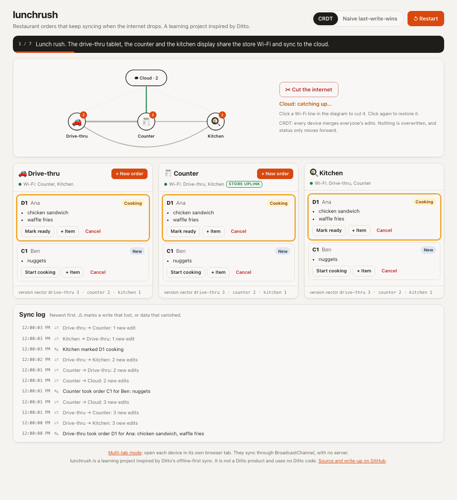
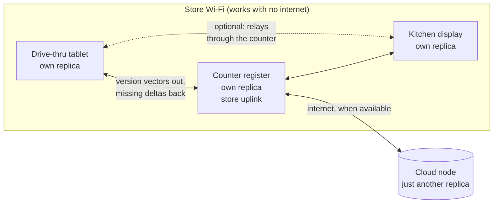

# lunchrush

**[▶ Live demo](https://abishekprabakar.github.io/lunchrush/)** · [How it works](EXPLAINER.md) · [Benchmark results](results.md)

[](https://abishekprabakar.github.io/lunchrush/)

A restaurant's drive-thru tablet, counter register and kitchen display keep taking and moving orders
through an internet outage. They sync with each other directly over the store Wi-Fi and catch the cloud
up when it comes back, with no lost orders, no duplicates and no lost edits.

> **A learning project inspired by [Ditto](https://ditto.com)** and its offline-first, peer-to-peer
> sync, including Chick-fil-A's use of it in their restaurants. lunchrush is not a Ditto product and
> uses no Ditto code. The merge logic is written by hand, without Automerge or Yjs, to understand how
> it really works.

## The story

In a typical cloud setup, every device in the store talks to a server. When the store's internet
drops, orders stop reaching the kitchen.

In lunchrush, every device keeps its own full copy of the orders and works on it locally, so nothing
waits for the network. Devices sync with whoever they can reach, and the cloud is just one more peer.
The hard part is the merge: two copies edited separately for ten minutes must combine without losing
anyone's work. That is what the **delta-state CRDTs** in `packages/core` do.

- Orders live in an **add-wins map**, and so do each order's line items.
- An order's status is a **forward-only register**:
  new → cooking → ready → canceled → picked up. A stale "cooking" can never overwrite "ready".
- Every edit gets a unique name (a *dot*). Each device keeps a **version vector** and sends a peer
  **exactly the edits it is missing**, not its whole state.
- The merge only uses set unions and maxes, so it is commutative, associative and idempotent.
  Messages can arrive in any order, through any relay, any number of times, and every device still
  ends up identical. Property tests check this on hundreds of random histories.

[EXPLAINER.md](EXPLAINER.md) walks through all of it for someone new to distributed systems.

## Try the demo

The [live demo](https://abishekprabakar.github.io/lunchrush/) runs three devices and a cloud node in
your browser, each with its own replica, talking only through a simulated network.

- **▶ Play lunch rush** runs a half-minute guided outage: the internet drops, the drive-thru tablet
  loses Wi-Fi, two devices edit the same order while apart, and someone taps a stale status.
- **Cut the internet**, or click any Wi-Fi line to partition two devices.
- Switch between the **CRDT** and **naive last-write-wins**, and play again to watch the naive engine
  lose an item and move an order backwards.
- The **sync log** shows every sync, and flags writes that lost to a further stage or data that
  vanished.
- **[Multi-tab mode](https://abishekprabakar.github.io/lunchrush/?mode=tabs)**: open each device in
  its own browser tab. The tabs sync through BroadcastChannel, with no server at all.

## Architecture



Every device gossips with the peers it can reach: it sends its version vector, and gets back only the
edits it lacks. Devices relay what they learn, so two that can't see each other still sync through a
third (multihop). One device, the store **uplink**, carries the store's traffic to the cloud, so the
cloud never downloads the same edits from every device at once.

| Package | What it is |
| --- | --- |
| [`packages/core`](packages/core) | Hybrid logical clocks, dots and version vectors, add-wins map, registers, `Replica.deltaFor` / `merge`, and the naive baseline. Example tests plus fast-check property tests. |
| [`packages/sim`](packages/sim) | A deterministic discrete-event network simulator (latency, jitter, loss, duplicates, bandwidth, partitions), anti-entropy gossip with a single uplink, and the lunch-rush benchmark. |
| [`apps/demo`](apps/demo) | The React demo: the simulated store in real time, and the BroadcastChannel multi-tab mode. |

## Results

`pnpm bench` runs a ten-minute outage with 200 new orders and 100 status edits on three devices and a
cloud node, over a lossy network, for each engine and five seeds. The summary below is pasted in by the
benchmark itself, and CI fails if the code changes without re-running it.

<!-- bench:summary -->
Measured by `pnpm bench` over 5 seeded runs of the lunch-rush outage (medians; full details in [results.md](results.md)).

| Engine | Orders lost | Status edits lost | Converged after reconnect | Total bytes | Internet bytes |
| --- | --: | --: | --: | --: | --: |
| CRDT, delta sync | 0 | 0 | 1.29 s | 0.89 MB | 0.19 MB |
| CRDT, full-state sync | 0 | 0 | 1.35 s | 48.71 MB | 0.40 MB |
| Naive last-write-wins | 37 | 20 | 0.85 s | 8.73 MB | 0.10 MB |

Delta sync sent 54.9x fewer bytes than full-state sync in total, but only 2.1x fewer over the internet. 2% of the bytes in delta-sync answers taught the receiver nothing new.

For delta sync, the single uplink cut internet bytes from 0.56 MB to 0.19 MB (67% less) and redundant answers from 35% to 2%, while time to converge after reconnect went from 1.28 s to 1.29 s (medians).
<!-- /bench:summary -->

The naive engine converges fastest only because its documents are smaller: it lost data.
[results.md](results.md) has every run, the network settings, and a before-and-after table for the
single uplink.

## Run it

Requires Node 20.19 or newer.

```sh
corepack enable     # provides the pinned pnpm version
pnpm install
pnpm all            # everything: lint, typecheck, all tests, the benchmark, and the demo build
pnpm dev            # the demo at http://localhost:5173
```

Or one step at a time: `pnpm check` (lint, typecheck, tests), `pnpm bench` (writes `results.md`),
`pnpm build` (the demo, into `apps/demo/dist`).

## Limitations

This is a learning project, and it cuts corners on purpose. [EXPLAINER.md](EXPLAINER.md) explains
the reasoning behind each design choice.

**What it doesn't do at all**

- **No Bluetooth, peer-to-peer Wi-Fi or real LAN networking.** Devices talk through the in-process
  simulator, or between browser tabs over BroadcastChannel. A real network mode (UDP multicast
  discovery and WebSockets between processes) is planned but not built.
- **No authentication or encryption.** Any peer can join, read everything and write anything, and
  messages are plain JSON.
- **No tombstone cleanup.** Removed items and cleaned-up orders leave tombstones forever, and every
  piece of state keeps the name of the edit that made it. Memory only grows.
- **No persistence.** Everything lives in memory. A reloaded tab starts empty and gets its data back
  from the other tabs.

**Simplifications in the design**

- **No undo for status.** Status only moves forward, so a mistaken "ready" can't go back to
  "cooking" without a separate correction mechanism.
- **Stages must form a single line.** The forward-only merge needs every pair of stages to be ordered.
  A stage alongside another (say "refunded" next to "picked up") needs a new design.
- **Cleanup is add-wins.** Removing a finished order only covers edits the device has seen, so a
  concurrent edit can bring a cleaned-up order back. It comes back still finished.
- **The uplink is chosen by id, not by who can reach the cloud.** With separate internet connections
  per device, a store whose uplink lost its own connection would stop syncing with the cloud. The
  choice also only looks at direct neighbours, so an unusual layout can elect two uplinks. That costs
  bytes, never correctness.
- **Requests in flight aren't tracked.** If an answer takes longer than one gossip round to arrive,
  the node asks again and gets the same edits twice. Harmless for correctness, wasteful on long
  outages over slow links.
- **Delta extraction scans the whole state** for every request, and the wire format is verbose JSON.
  Fine for a few hundred orders, not for a real store's history.

**How Ditto's real system goes further** (from its public documentation)

- It syncs over [several transports at once](https://docs.ditto.live/sync/transports-overview):
  Bluetooth LE, LAN, peer-to-peer Wi-Fi and WebSockets, racing them and switching between them, and
  forms a [mesh](https://docs.ditto.live/key-concepts/mesh-networking) of devices.
- It has a server peer, the "Big Peer", alongside the devices ("Small Peers"), and authentication for
  production deployments.
- Devices keep a persistent on-device store and declare
  [subscriptions](https://docs.ditto.live/sdk/v4/sync/syncing-data): queries that decide which data
  they sync, instead of syncing everything.
- It has local eviction, to free storage without deleting data for other peers, and production-grade
  engineering everywhere lunchrush keeps things simple.

## Layout

```
packages/core/src
  hlc.ts             hybrid logical clock
  causal-context.ts  dots, version vectors, causal contexts
  register.ts        registers: last-writer-wins, and forward-only for order status
  awmap.ts           add-wins map with tombstones
  order-doc.ts       the order document: merge, delta extraction, view
  replica.ts         one device: local edits, deltaFor(versionVector), merge(delta)
  baseline.ts        naive whole-document last-write-wins, for comparison
packages/core/test   example tests plus fast-check property tests

packages/sim/src
  simulation.ts      discrete-event clock and event queue
  network.ts         links with latency, jitter, loss, duplicates, bandwidth and partitions
  engines.ts         the three things being compared: CRDT delta, CRDT full-state, naive baseline
  gossip.ts          a node running anti-entropy gossip (version vectors out, missing edits back)
  uplink.ts          the single-uplink rule for the store's cloud traffic
  workload.ts        the staff's orders and status edits, generated from a seed
  lunch-rush.ts      the outage scenario and its scoring
  report.ts, bench.ts  results.md and the summaries above

apps/demo/src
  world.ts           the simulated store, driven in real time, with the sync log
  script.ts          the guided lunch rush
  tabs.ts            multi-tab mode over BroadcastChannel
  station.ts         what a device's screen can do, shared by both modes
  ui/                React components
```
